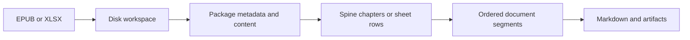

# Feature: EPUB and Spreadsheet Conversion

Links: [Architecture](../Architecture/Overview.md), [disk-first workspace](../ADR/ADR-0001-disk-first-workspace-pipeline.md), [segment metadata](../ADR/ADR-0003-segment-metadata-contract-for-markdown.md).

## Implementation plan (step-by-step)

- [x] Inspect the EPUB container, package metadata and reading-order paths, and XLSX table rendering.
- [x] Add regression scenarios for real EPUB content and multiline spreadsheet cells.
- [x] Correct extraction and table rendering.
- [x] Verify converter regressions with Debug/Release full suites and analyzers; see [10.0.8 review](../Development/Review-10.0.8.md) for six external manual prerequisite failures.

## Purpose

Preserve ebook content and spreadsheet cell boundaries in Markdown. A successful conversion must contain the source text, and table line breaks must not turn one source row into several Markdown rows.

## Stakeholders

| Role | Need |
| --- | --- |
| Product | Readable ebooks and spreadsheets with faithful content |
| Engineering | Explicit reading order, metadata keys and cell rendering |
| DevOps | Existing workspace persistence and converter diagnostics |
| QA | Real fixture coverage without cloud credentials |

## Scope

EPUB container/package interpretation, chapter order, title/author metadata, and XLSX multiline table cells are in scope. Provider enrichment, new formats and public API changes are outside this change.

## Business Rules

1. Standard EPUB container namespaces work whether declared as the default namespace or with a prefix. Existing namespace-free containers remain readable.
2. Chapters follow package spine order, independently of archive entry names or manifest order. Each chapter retains explicit numeric segment/page metadata.
3. The package title is the document title. Package metadata uses canonical `epub.title` and `epub.author` keys without duplicate prefixes; human-readable metadata labels omit the prefix.
4. XLSX inline and shared strings preserve embedded line breaks as ` ` inside one Markdown table cell. LF, CRLF and CR each represent one break. Literal pipes are escaped.
5. Ordinary empty DOCX table cells remain empty; explicit merges are handled as documented in [structured document conversion](structured-docx-pdf-conversion.md).

## User Flows

1. A caller converts an EPUB file: materialize to disk, read the container's package path, extract metadata and the spine, render each chapter, then compose ordered segments and persist Markdown.
2. A caller converts an XLSX file: open the workbook, read inline/shared values, build sheet rows, escape table cells, then compose sheet segments and persist Markdown.

Empty XLSX sheets produce the existing no-data message. Broken workbook packages fail conversion. Reversing an EPUB spine reverses chapter output without changing chapter content.

## System Behaviour

Entry points are `EpubConverter.ConvertAsync`, `XlsxConverter.ConvertAsync`, and client routing to those converters. They read local package data and write segments, artifacts and configured workspace output through the existing document pipeline. Content ordering is deterministic for the same source and options; generated timestamps and workspace paths can differ. Package processing uses caller cancellation and existing converter failure diagnostics. These changes add no services, credentials, dependencies or feature flags.

## Diagrams

## Verification

The .NET 10 integration tests use `TestAssetCatalog.AutogenEbookEpub`, temporary copies with modified container/spine data, and disk-backed OpenXML workbooks. No cloud services are needed for these converter regressions. The complete solution run also includes `ManualConversionDebugTests` under the repository's configured integration environment.

| Scenario | Test | Expected result |
| --- | --- | --- |
| Standard EPUB | `EpubConverterTests.ConvertAsync_StandardEpub_PreservesTitleMetadataAndChapters` | Real title, canonical author metadata, chapter text and numeric page metadata |
| Container variants and reverse spine | `EpubConverterTests.ConvertAsync_EpubContainerVariants_PreserveSpineOrder` | Prefixed and namespace-free containers retain reversed reading order |
| Multiline XLSX | `XlsxConverterTests.ConvertAsync_XlsxWithMultilineCells_KeepsMarkdownRowsIntact` | Inline/shared strings keep LF, CRLF and CR inside their table row |
| Empty workbook | `XlsxConverterTests.ConvertAsync_EmptyXlsx_ProducesNoDataMessage` | No-data output |
| Broken workbook | `XlsxConverterTests.ConvertAsync_BrokenXlsx_RaisesFileConversionError` | Typed failure through client conversion |

Commands: `dotnet build MarkItDown.slnx`, `dotnet test MarkItDown.slnx`, `dotnet format MarkItDown.slnx`, `dotnet build MarkItDown.slnx -p:RunAnalyzers=true`, and `dotnet test MarkItDown.slnx --collect:"XPlat Code Coverage"`.

## Definition of Done

All mapped converter scenarios pass, the required solution checks are completed, and the architecture index links to these behavior rules. No new public contracts or architectural boundaries are introduced.
