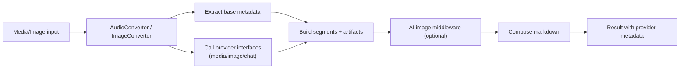

# Feature: Media and Image Intelligence Enrichment

Links:  
Architecture: `docs/Architecture/Overview.md`  
Modules: `src/MarkItDown/Converters/Media`, `src/MarkItDown/Intelligence`, `src/MarkItDown/Conversion/Middleware`  
ADRs: `docs/ADR/ADR-0002-middleware-first-enrichment-orchestration.md`, `docs/ADR/ADR-0004-extensible-provider-and-converter-abstractions.md`

---

## Implementation plan (step-by-step)

- [x] Analyze audio/image converter enrichment flow
- [x] Document provider abstraction behavior and failure rules
- [x] Capture image chat enrichment expectations and output policy
- [x] Link to tests and live integration suites

---

## Purpose

Enable richer media conversion by combining baseline metadata extraction with optional provider-driven intelligence (transcription, OCR, image understanding, AI chat enrichment) while preserving deterministic markdown output contracts.

---

## Stakeholders (who needs this to be clear)

| Role | What they need from this spec |
| --- | --- |
| Product / Owner | Better media understanding in markdown output |
| Engineering | Provider invocation rules and failure semantics |
| DevOps / SRE | Cloud provider configuration and observability expectations |
| QA | Confidence that enrichment behavior is covered in tests |

---

## Scope

### In scope

- `AudioConverter` transcription and metadata flow
- `VideoConverter` routing for `video/*` inputs
- `ImageConverter` metadata/caption flow
- AI image enrichment middleware/chat enrichment flow
- Provider abstraction interfaces and request overrides

### Out of scope

- UI presentation of enriched media content
- Provider-specific billing/governance policies

---

## Business Rules

- An explicit media provider selection requires that provider to be configured. A missing selection fails before any other provider or audio transcription delegate can receive the content.
- Google Speech-to-Text V1 requests word offsets and maps each recognized segment to its first word's start and last word's end. Direct audio is limited to 10 MB and 60 seconds. Longer recordings require a private Google Cloud Storage object and a batch recognition request. [Google V1 quotas](https://docs.cloud.google.com/speech-to-text/docs/v1/quotas).
- Video Indexer processing must wait for `Processed` and fail with a clear timeout/config error if processing does not complete in the configured window.
- Azure Video Indexer requests carry the account token as a bearer header. Provider status logs and failure messages omit response payloads and signed source URLs. Reading an index without a requested language retrieves its original transcript.
- For Azure Video Indexer uploads, prefer `videoUrl` when `StreamInfo.Url` is a valid `http/https` source (for example read-only SAS URL); use multipart stream upload only when no valid source URL is available.
- `MediaTranscriptionRequest.SourceUrl` must override `StreamInfo.Url` for Azure Video Indexer upload source selection, and invalid (non-`http/https`) override values must fail fast.
- `MediaTranscriptionRequest.UploadRoute` controls provider upload routing: `Auto`, `Stream`, `SourceUrl`, `StorageUrl`.
- `UploadRoute=StorageUrl` requires `AzureMediaIntelligenceOptions.UploadStorageFactory`; missing storage factory, missing local file path, or missing public HTTP/S URI in upload metadata must fail fast.
- Image enrichment must reject missing MIME metadata and preserve one canonical image placeholder/description path in final markdown.
- Image descriptions preserve literal dollar sequences such as `$&`, `$$`, and `$1`; replacement of a legacy image block must not interpret description text as regular-expression replacement syntax.
- If AI image enrichment returns no insight, treat it as soft failure (log and continue).
- Middleware validates pending image MIME metadata before provider calls and propagates configuration errors, caller cancellation (including wrapped provider cancellation), and authentication/authorization failures. Optional provider failures outside those categories retain the existing log-and-continue policy.
- Media routing must avoid URL-converter interception for uploaded `audio/*` or `video/*` media.
- Video transcript output must include rich context (timing/speaker/sentiment/topics/keywords plus Video Indexer state/index/progress metadata when available).

---

## User Flows

### Primary flows

1. Convert an audio/video file with media transcription enabled  
   - Actor: library caller  
   - Trigger: media conversion request with provider options  
   - Steps: route `video/*` to `VideoConverter`/`AudioConverter` -> extract metadata -> choose upload route (`UploadRoute`) and source URL (`SourceUrl` override, URL metadata, or storage-generated public URL) -> upload via `videoUrl` or multipart stream -> poll provider -> build transcript + analysis segments -> compose markdown  
   - Result: markdown containing metadata and transcript segments.

2. Convert an image with AI enrichment enabled  
   - Actor: library caller  
   - Trigger: image conversion path + AI provider availability  
   - Steps: extract image metadata/artifact -> run understanding/chat enrichment -> produce final placeholder + description markdown  
   - Result: markdown and artifacts enriched with OCR/caption insight.

### Edge cases

- Provider auth failure -> converter failure surfaced as `FileConversionException` with auth context.
- Video Indexer processing timeout -> conversion fails with last known state/progress in the error.
- No transcript segments for required media request -> hard failure.
- Empty image chat response -> log and keep baseline image output.

---

## System Behaviour

- Entry points: media/image converter selection via `MarkItDownClient`
- Reads from: source media files and provider outputs
- Writes to: audio/image segments, artifact metadata, provider metadata markers
- Side effects / emitted events: optional remote provider calls, logs/telemetry
- Idempotency: deterministic absent provider-side nondeterminism
- Error handling: explicit `FileConversionException` for required provider failures
- Security / permissions: provider credentials from options/request overrides
- Feature flags / toggles: segment options + per-request intelligence overrides
- Performance / SLAs: disk-backed input and persisted artifacts mitigate memory pressure
- Observability: converter failure details, media transcription activity tags, and provider/video index metadata

---

### Resumable Google Speech V2 transcription

[Google Speech V2 batch transcription](google-speech-v2-transcription.md) stages a private recording, resumes native Google operations after restart, and returns source-aligned speech segments for supported audio and video containers.

### Resumable Azure Video Indexer transcription

Applications that own durable ingestion can call the Azure provider directly. Each lifecycle method performs one Video Indexer operation after authentication. The conversion API still supports its existing upload routes and managed wait.

1. Persist an opaque external ID with the original recording authorization. Call `AzureMediaTranscriptionProvider.SubmitAsync` once with the original file stream and its spoken language. It streams multipart to the authorized account, requests private Basic Audio indexing with no streaming rendition, and sets Azure's one-day retention backstop.
2. Save the returned video ID. If the upload outcome is uncertain, call `FindVideoIdAsync` using the same external ID. A missing search result can mean delayed visibility. Treat this as unresolved until readback or the application's deadline. Multiple matches fail closed.
3. Call `ReadAsync` with the exact video ID on separate durable steps. An accepted or processing recording returns `Pending`. A processed recording returns the original-language text and its time intervals. A failed or quarantined recording returns `Failed`.
4. Call `DeleteAsync` for the exact provider recording after the application's result becomes durable or when ingestion stops. The provider retains no application-provided media URL or public playback rendition. An already deleted recording is successful.

Use an HTTP transport configured to avoid upload retries and redirects. The default Video Indexer transport disables redirects. Bearer credentials stay in request headers and are refreshed through the configured account identity. Uploaded filenames use the opaque external ID and recording extension. [Azure Video Indexer API](https://api-portal.videoindexer.ai/) · [Indexing and retention](https://learn.microsoft.com/en-us/azure/azure-video-indexer/indexing-configuration-guide)

## Diagrams

---

## Verification

### Test environment

- Environment / stack: local tests with stubs + optional live provider integration
- Data and reset strategy: fixture media files in test catalog
- External dependencies: live tests require provider credentials and network access

### Test commands

- build: `dotnet build MarkItDown.slnx`
- test: `dotnet test MarkItDown.slnx`
- format: `dotnet format MarkItDown.slnx`
- coverage: `dotnet test MarkItDown.slnx --collect:"XPlat Code Coverage"`

### Test flows

**Positive scenarios**

| ID | Description | Level (Unit / Int / API / UI) | Expected result | Data / Notes |
| --- | --- | --- | --- | --- |
| POS-001 | Audio converter emits metadata/transcript segments | Integration | Transcript section and metadata returned | `tests/MarkItDown.Tests/AudioConverterTests.cs` |
| POS-002 | Image chat enrichment populates insights | Integration | Enrichment content added to artifacts/markdown | `tests/MarkItDown.Tests/Intelligence/ImageChatEnricherTests.cs` |

**Negative scenarios**

| ID | Description | Level (Unit / Int / API / UI) | Expected result | Data / Notes |
| --- | --- | --- | --- | --- |
| NEG-001 | Required media provider fails | Integration | Error surfaced with provider context | `tests/MarkItDown.Tests/MarkItDownTests.cs` |
| NEG-002 | Missing MIME metadata for AI image enrichment | Integration | Failure surfaced instead of fallback MIME | `tests/MarkItDown.Tests/Intelligence/ImageChatEnricherTests.cs` |
| NEG-003 | Image middleware configuration, cancellation, and auth errors | Integration | Required failures propagate; optional HTTP 503 preserves baseline segment | `tests/MarkItDown.Tests/Conversion/AiModelPipelineTests.cs` |

**Edge cases**

| ID | Description | Level (Unit / Int / API / UI) | Expected result | Data / Notes |
| --- | --- | --- | --- | --- |
| EDGE-001 | Video media input with URL metadata | Integration | Routed through media path, not URL video-platform resolver path | `tests/MarkItDown.Tests/ConverterAcceptanceTests.cs` |
| EDGE-002 | Live Azure media transcription path | Integration (live) | Provider transcript segments marked as azure video indexer with transcript + analysis sections | `tests/MarkItDown.Tests/Intelligence/Integration/AzureIntelligenceIntegrationTests.cs` |
| EDGE-003 | Azure Video Indexer upload with HTTP/S source URL | Unit/Integration | Upload request uses `videoUrl` query without multipart body | `tests/MarkItDown.Tests/Intelligence/VideoIndexerClientTests.cs` |
| EDGE-004 | Azure upload source override via request | Unit/Integration | `MediaTranscriptionRequest.SourceUrl` wins over `StreamInfo.Url`; invalid override fails fast | `tests/MarkItDown.Tests/Intelligence/AzureMediaTranscriptionProviderTests.cs` |
| EDGE-005 | Azure upload route selection | Unit/Integration | `UploadRoute.Stream` forces multipart; `UploadRoute.StorageUrl` requires configured uploader and emits `videoUrl` | `tests/MarkItDown.Tests/Intelligence/AzureMediaTranscriptionProviderTests.cs` |
| EDGE-008 | Google Speech V1 timed audio and direct size limit | Provider boundary | Requests word offsets, returns the recognized range, and rejects oversized inline input before sending it | `tests/MarkItDown.Tests/Intelligence/GoogleProvidersTests.cs` |
| EDGE-009 | Explicit media provider routing | Public conversion API | A missing selection does not call the default provider. A configured selection returns its timed transcript without calling another transcription delegate. | `tests/MarkItDown.Tests/MarkItDownTests.cs` |
| EDGE-010 | Resumable Google Speech V2 batch transcription | Storage and provider boundary | Staging preserves source bytes, a recreated provider reads timed text from the native operation, and cancellation and private cleanup follow provider state | `tests/MarkItDown.Tests/Intelligence/GoogleSpeechV2TranscriptionProviderTests.cs` |
| EDGE-006 | AI image insight includes shell/regex dollar sequences | Integration | DOCX conversion and replacement of an existing image segment retain the complete literal description | `AiModelPipelineTests.ImageEnrichment_PreservesLiteralRegexReplacementTokens`, `AiModelPipelineTests.ImageEnrichment_ExistingImageSegmentPreservesLiteralRegexReplacementTokens` |
| EDGE-007 | Azure Video Indexer protocol diagnostics and language | Provider HTTP contract | Upload and index requests keep tokens out of URLs, an index read preserves the original language, and timeout errors omit provider payloads | `tests/MarkItDown.Tests/Intelligence/VideoIndexerClientTests.cs` |
| EDGE-010 | Azure Video Indexer resumable transcription | Public provider lifecycle | One private upload streams the original recording. Recovery reads the same external ID, the finished state yields original speech and measured times, and deletion succeeds for the exact video ID. Unknown or duplicate recovery IDs and failed recordings never produce a transcript. | `tests/MarkItDown.Tests/Intelligence/AzureMediaTranscriptionProviderTests.Lifecycle.cs` |

### Test mapping

- Integration tests: `tests/MarkItDown.Tests/AudioConverterTests.cs`, `tests/MarkItDown.Tests/Intelligence/ImageChatEnricherTests.cs`, `tests/MarkItDown.Tests/ConverterAcceptanceTests.cs`
- API tests: N/A
- UI / E2E tests: N/A
- Unit tests: provider and helper-specific test cases under `tests/MarkItDown.Tests/Intelligence/*`
- Static analysis: analyzers enforced during build

---

## Definition of Done

- Media/image enrichment contract is explicit and test-backed.
- Failure policy for provider errors is documented and enforced.
- Live integration suites and skip/fail conditions are documented.

---

## References

- `src/MarkItDown/Converters/Media/AudioConverter.cs`
- `src/MarkItDown/Converters/Media/VideoConverter.cs`
- `src/MarkItDown/Converters/Media/ImageConverter.cs`
- `src/MarkItDown/Intelligence/Providers/Azure/VideoIndexer/VideoIndexerClient.cs`
- `src/MarkItDown/Intelligence/ImageChatEnricher.cs`
- `tests/MarkItDown.Tests/AudioConverterTests.cs`
- `tests/MarkItDown.Tests/Intelligence/ImageChatEnricherTests.cs`
