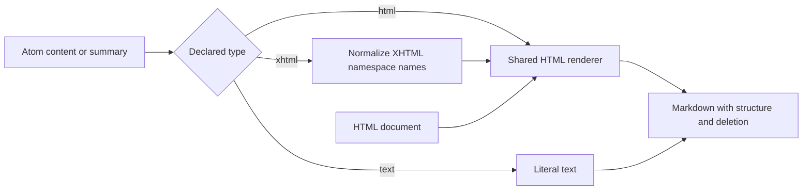

# Feature: Web Markup Fidelity

Links: [Architecture](../Architecture/Overview.md), [Routing](format-detection-and-converter-routing.md), [Review 10.0.8](../Development/Review-10.0.8.md).
Modules: `src/MarkItDown/Converters/Web/HtmlMarkdownRenderer.cs` and `RssFeedConverter.cs`.

## Implementation plan (step-by-step)

- [x] Compare Atom text constructs and strikethrough against current upstream behavior.
- [x] Reproduce lost content/formatting through public converter APIs.
- [x] Preserve Atom declared content types and HTML strikethrough.
- [x] Review prefixed XHTML, styled structural elements, and CSS declaration order.
- [x] Record final build, regression, formatting and analyzer results in the linked review; mandatory manual prerequisites remain explicitly blocked.

## Purpose and stakeholders

Preserve authored meaning when feed entries and HTML pages become Markdown. Product owners need faithful content; engineering needs explicit parsing behavior; QA needs file-based regression scenarios; operations needs reproducible checks without a new cloud dependency.

## Scope

In scope: Atom content/summary text, HTML and XHTML constructs; native HTML deletion tags; inline text-decoration declarations. Out of scope: external stylesheets, a complete CSS layout/cascade engine, a new feed reader API, and additional providers.

## Business Rules

1. Atom absent/text types preserve literal text, including decoded angle brackets; they are not interpreted as HTML.
2. Atom HTML is entity-decoded by XML parsing and rendered through the shared HTML renderer.
3. Atom XHTML preserves element structure for both default and prefixed XHTML namespaces.
4. HTML `s`, `del`, `strike` and supported inline line-through declarations emit Markdown deletion markers.
5. Applying inline deletion must preserve link destinations, heading levels and paragraph boundaries.
6. Later text-decoration declarations replace earlier declarations unless the earlier declaration is important and the later one is not.

## User Flows

A caller passes a file-backed Atom or HTML stream to the corresponding converter. The feed converter selects content before summary and renders by the declared content type. The HTML renderer preserves element structure and inline deletion. Markdown is returned through the existing result contract.

Edge cases include text that resembles HTML, namespace prefixes, multiple decoration tokens, overridden declarations and important declarations.

## System Behaviour

The converters read caller streams and construct Markdown with the existing XML/AngleSharp dependencies. No remote calls, persistent state, flags, or new configuration are added. Identical input yields identical markup. XML parse errors retain the converter's typed error behavior. Existing converter-selection logging remains in the client.

## Diagram

## Verification

.NET 10 tests use temporary disk files and clean them after conversion. No provider mocks or cloud services are needed for these converter cases. Full-suite runs still include the required manual/live suites.

| Scenario | Test | Expected result |
| --- | --- | --- |
| Atom text, HTML and XHTML content/summary | `UpstreamWebParityTests.AtomTextConstructs_PreserveContentType` | Literal text retained; HTML/XHTML formatting retained |
| Prefixed XHTML | `UpstreamWebParityTests.AtomTextConstructs_PreserveContentType` | Same bold output as default namespace |
| Deletion tags and span styles | `UpstreamWebParityTests.HtmlStrikethrough_PreservesDeletedText` | Deletion markers surround text |
| Styled links, headings and paragraphs | `UpstreamWebParityTests.HtmlStrikethrough_PreservesElementSemanticsAndCssOrder` | Structure and destination preserved |
| Decoration overridden with none | `UpstreamWebParityTests.HtmlStrikethrough_PreservesElementSemanticsAndCssOrder` | Current text remains unstruck |
| Important declaration followed by normal none | `UpstreamWebParityTests.HtmlStrikethrough_PreservesElementSemanticsAndCssOrder` | Important deletion retained |

Commands: `dotnet build MarkItDown.slnx`, `dotnet test MarkItDown.slnx`, `dotnet format MarkItDown.slnx`, `dotnet build MarkItDown.slnx -p:RunAnalyzers=true`, `dotnet test MarkItDown.slnx --collect:"XPlat Code Coverage"`.

## Definition of Done

All listed scenarios pass with public converter output assertions; formatting/analyzers pass; architecture and behavior documentation link this feature. Full repository release readiness remains subject to all mandatory manual prerequisites documented in [Testing](../Testing/Overview.md). Exact run outcomes are in the [review](../Development/Review-10.0.8.md).
